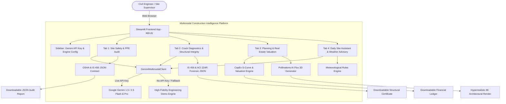

# 🏗️ Multimodal Construction Intelligence Platform
### Skill Wallet Capstone Project 1 • Production-Ready Streamlit Application

[](https://streamlit.io/)
[](https://www.python.org/)
[](https://opensource.org/licenses/MIT)
[](#standards-compliance)

A full-stack multimodal AI engineering platform purpose-built for the construction, structural forensics, and real estate development industries. Integrates computer vision with Google Gemini models, standard civil engineering codes (OSHA 29 CFR 1926, IS 456:2000, ACI 224R), dynamic CapEx forecasting with S-curve modeling, and 3D conceptual architectural generation via Pollinations AI.

---

## 📋 Kanban Epics Matrix

| Epic | Module Name | Scope & Engineering Implementation | Status |
| :--- | :--- | :--- | :---: |
| **Pre-reqs** | Tech Stack & Setup | Python 3.9+, venv/uv isolation, Streamlit, Pillow, Plotly, Google GenAI SDK | ✅ Completed |
| **Epic 1** | Requirements & Env | Modular architecture, environment variables, theme styling, zero-DB cloud config | ✅ Completed |
| **Epic 2** | Safety Vision & Crack Diagnostics | Worker PPE compliance auditing (OSHA/IS 456), concrete crack morphology & repair protocols | ✅ Completed |
| **Epic 3** | Planning & Real Estate Valuation | Dynamic CapEx budget, S-curve expenditure, Indian Tier 1/2/3 market valuation, 3D Pollinations render | ✅ Completed |
| **Epic 4** | Multimodal AI & JSON Contracts | Structured schema validation, markdown code-fence sanitization, demo fallback engine | ✅ Completed |
| **Epic 5** | Site Chatbot & Weather Advisory | Meteorological hazard engine, multi-turn AI civil engineer chatbot with IS/OSHA knowledge base | ✅ Completed |
| **Epic 6** | Interface, Testing & Deployment | Industrial dark CSS, unit/interactive AppTest suite, 1-click Streamlit Community Cloud readiness | ✅ Completed |

---

## 🏛️ System Architecture



---

## 🚀 Key Modules & Capabilities

### 1. Sidebar & Configuration
- **Secure Gemini API Key Input:** Uses password field; key stays in memory and is never logged.
- **Graceful Demo Fallback Mode:** When no API key is provided, the platform automatically engages realistic civil engineering simulation mode with zero runtime errors.
- **Model Selector:** Choose between `gemini-1.5-flash`, `gemini-2.5-flash`, and `gemini-1.5-pro`.
- **Force Offline Mode Toggle:** Allows deterministic testing of mock contracts even when a live key is present.
- **Architecture Specs & Epics Overview:** Live system metadata display.

---

### 2. Tab 1 – Site Safety & PPE Audit (Epic 2 & 4)
- **Multimodal Visual Inspection:** Evaluates construction site imagery against:
  - **OSHA 29 CFR 1926.100 / IS 2925:** Safety Helmets / Class E Hard Hats
  - **OSHA 1926.201 / IS 15809:** High-Visibility Retroreflective Apparel
  - **OSHA 1926.96 / IS 15298:** Steel-Toe Protective Footwear
  - **OSHA 1926.501 / IS 3521:** Fall Protection Harnesses & Static Lifelines
  - **OSHA 1926.701 / IS 456:** Uncapped vertical rebar impalement hazards
- **Structured JSON Contract Output:**
  ```json
  {
    "safety_score": 82,
    "overall_status": "Minor Violations",
    "workers_detected_count": 4,
    "workers_compliant_count": 3,
    "ppe_detection": [...],
    "identified_site_hazards": [
      {
        "hazard_id": "HAZ-001",
        "title": "Uncapped Vertical Starter Bars",
        "severity": "Critical",
        "standard_violated": "OSHA 1926.701(b) / IS 456",
        "corrective_remedy": "Fit OSHA-approved steel-reinforced mushroom caps.",
        "immediate_stop_work": true
      }
    ]
  }
  ```
- **UI Presentation:** Metric cards, status pills (🟢 Compliant, 🟡 Minor, 🟠 High, 🔴 Critical), PPE matrix, stop-work alerts, and 1-click JSON report download.

---

### 3. Tab 2 – Crack Diagnostics & Structural Integrity (Epic 2)
- **Defect Pathology Classification:**
  1. *Hairline Crack:* Plastic/drying shrinkage ($<0.3\text{ mm}$ width, elastomeric bridging)
  2. *Settlement Crack:* Differential foundation shifting, diagonal stepped masonry cracks
  3. *Structural Shear Crack:* $45^\circ$ diagonal tensile shear distress in RC beams (Critical, violates IS 456 Clause 35.3.2)
  4. *Thermal Expansion Crack:* Diurnal thermal fatigue, missing expansion joint
  5. *Spalling & Rebar Delamination:* Carbonation attack, chloride corrosion, expanding rust cover loss
- **Forensic Metrics:** Crack width measurement (mm), depth category, structural integrity index ($0-100$), IS 456:2000 serviceability limit check.
- **Technical Repair Protocols:** Step-by-step engineering execution sequences for low-pressure epoxy injection (ASTM C881 Type IV), CFRP carbon composite wrapping, and polymer-modified structural mortar (EN 1504 Class R4).

---

### 4. Tab 3 – Planning & Real Estate Valuation (Epic 3)
- **Interactive Inputs:** Structure typology (Residential High-Rise G+20, Commercial Grade A, Luxury Villa, Warehouse PEB), built-up square footage, Indian market tier (Tier 1 Mumbai/Bengaluru, Tier 2 Ahmedabad/Kochi, Tier 3), and completion percentage slider.
- **Civil Engineering Equations:**
  - **Total CapEx Budget:**
    $$\text{CapEx} = \text{Sqft} \times \text{Base Rate} \times \text{Quality Multiplier} + \text{MEP (18\%)} + \text{Statutory \& Contingency (12\%)}$$
  - **S-Curve Incurred Expenditure:**
    $$p = \frac{\text{Progress \%}}{100}, \quad S(p) = 3p^2 - 2p^3, \quad \text{Incurred CapEx} = \text{CapEx} \times S(p)$$
  - **Asset Valuation in INR:** Computes as-is market asset valuation in INR Crores ($\text{₹ Cr}$) and Lakhs ($\text{₹ L}$) with RERA completion risk adjustments.
  - **CPWD Material Takeoff:** Structural steel (Fe500D TMT in MT), cement (50kg bags & MT), coarse aggregate, manufactured sand (cft), and curing water (KL).
- **3D Architectural Rendering via Pollinations AI:** Generates photorealistic architectural prompts and dynamically streams 8K visualizations with style, lighting, and seed controls.

---

### 5. Tab 4 – Daily Site Assistant & Weather Advisory (Epic 5)
- **Dynamic Weather Rules Engine:**
  - *High Wind ($>45\text{ km/h}$):* OSHA 1926.1431 crane weather-vaning, loose cladding tie-downs.
  - *Heavy Rain ($>50\text{ mm/hr}$):* Concrete pour halt (IS 456 Clause 13.3), trench dewatering, 415V GFCI protection.
  - *Extreme Heat ($>40^\circ\text{C}$):* ACI 305R ice-batching, plastic shrinkage mitigation, OSHA heat illness breaks.
  - *Normal / Favorable:* Full operations clearance.
- **Multi-Turn Civil Engineering Chatbot:**
  - Maintains conversation history across turns.
  - Quick prompt chips for standard questions (IS 456 curing periods, crane wind limits, power line clearances, formwork striking times).
  - Delivers code citations (IS 456 Clause 11.3, OSHA Subpart M/P).

---

## 🛠️ Local Installation & Setup

### Using `uv` (Recommended)
```bash
# Clone or navigate to the directory
cd "Multimodal Construction Intelligence Platform"

# Create a local virtual environment with uv
uv venv .venv

# Activate environment (Windows)
.venv\Scripts\activate
# Or on Linux/macOS:
# source .venv/bin/activate

# Install dependencies using uv
uv pip install -r requirements.txt

# Run the Streamlit application
streamlit run app.py
```

### Using standard `python -m venv`
```bash
python -m venv .venv
.venv\Scripts\activate
pip install -r requirements.txt
streamlit run app.py
```

The app will open automatically at `http://localhost:8501`.

---

## 🧪 Automated Testing & Verification

Comprehensive unit tests and interactive Streamlit AppTests are provided in `tests/`:

```bash
# 1. Run unit & contract tests
python tests/test_platform.py

# 2. Run interactive Streamlit AppTest suite (exercises buttons, tabs, state mutations)
python tests/test_app_interactive.py
```

---

## ☁️ 1-Click Streamlit Community Cloud Deployment

1. Push this repository to GitHub.
2. Visit [share.streamlit.io](https://share.streamlit.io).
3. Select your repository, branch (`main`), and set **Main file path** to `app.py`.
4. (Optional) In **Advanced Settings -> Secrets**, add:
   ```toml
   GEMINI_API_KEY = "AIzaSy..."
   ```
5. Click **Deploy!** The application requires **zero external database setup** and is 100% operational in both live and demo simulation modes out of the box.

---

## 📜 Regulatory Standards & Codes Referenced
- **OSHA 29 CFR 1926:** Safety and Health Regulations for Construction
- **IS 456:2000:** Plain and Reinforced Concrete - Code of Practice (Bureau of Indian Standards)
- **IS 13415:1992:** Code of Safety for Working on Scaffolds
- **IS 2925:1984:** Specification for Industrial Safety Helmets
- **IS 3521:1999:** Industrial Safety Belts and Harnesses
- **ACI 224R-01:** Control of Cracking in Concrete Structures
- **ACI 305R / 306R:** Hot and Cold Weather Concreting Guides
- **CPWD Plinth Area Rates & Civil Norms (2024-2026)**
